# StudentNest 🏠

> Find a boarding near your campus.

StudentNest is a web application that helps university students in Sri Lanka find boarding places (rented rooms) close to their campus. Students search by campus, see the distance and travel time, request a room, and get the owner's contact details after the owner approves. Boarding owners list their places with photos, and an admin approves every account and every listing.

## 🔗 Live demo

| | Link |
|---|---|
| Website (frontend) | https://student-nest-frontend-xi.vercel.app |
| API (backend) | https://student-nest-backend-three.vercel.app/health |
| Frontend repository |https://github.com/siumithathsara/StudentNest-Frontend.git |
| Backend repository | https://github.com/siumithathsara/StudentNest-Backend.git |

## 👤 About

- **Name:** Imakshi Siyumi Thathsara
- **Module / Assignment:**ITS2020 - Rapid Application Development (RAD)   

## 🛠 Tech stack

| Area | Technologies |
|---|---|
| **Frontend** | React 19, TypeScript, Vite, Tailwind CSS 4, Redux Toolkit, React Router, Axios, Leaflet (maps) |
| **Backend** | Node.js, Express 5, TypeScript |
| **Database** | MongoDB Atlas with Mongoose (geospatial `2dsphere` index and `$geoNear` queries) |
| **Authentication** | JWT (access + refresh tokens), bcrypt password hashing, role-based access (Student / Owner / Admin) |
| **Validation and security** | Zod validation, Helmet, rate limiting, CORS allow-list |
| **File storage** | Supabase Storage (boarding photos, uploaded with Multer) |
| **AI** | Google Gemini API (chat assistant) |
| **Email** | Nodemailer with Gmail SMTP |
| **Maps and places** | OpenStreetMap (Nominatim place search through our own API), Leaflet |
| **Hosting** | Vercel (frontend and backend), MongoDB Atlas, Supabase |

## ✨ Features

### For everyone
- Register as a **student** or a **boarding owner**. An **admin approves every account** before it can log in.
- Secure login with JWT (access and refresh tokens), "keep me signed in" and show/hide password
- **Forgot password** by email (a single-use link that expires in 30 minutes)
- In-app **notifications** (bell icon) and **email notifications** for approvals, bookings and cancellations
- **AI chat assistant** (Google Gemini): students can search in plain English, owners and admins get help using the website
- Responsive design for phones, tablets and desktops

### For students
- Find a boarding near a chosen campus, with **distance and walking / vehicle travel-time estimates**
- Filters: distance, rent range, facilities, free rooms only. Sorting: nearest, rent, newest. Pagination.
- Home page shows boardings near the student's saved campus
- Boarding details: photo gallery, facilities, nearby campuses, approximate map location and a **monthly cost calculator**
- **Favorites** and **Compare** (up to 3 boardings side by side)
- **Request a room** with a move-in date and a message (up to 3 pending requests, one active request per boarding)
- **My bookings**: track and cancel requests. After approval, the owner's **phone, email and exact address** appear.

### For boarding owners
- Add, edit and delete boardings: details, rent, rooms, facilities, **location picked on a map** and **photo upload** (photos are compressed in the browser)
- Nearby campuses are shown live while choosing the location
- **Booking requests:** approve, reject or cancel (a reason is required to reject or cancel)
- The number of free rooms updates **atomically**, so a room can never be booked twice. When the last room is taken, the other pending requests are closed automatically.
- A boarding that has pending or approved bookings cannot be deleted

### For admins
- Dashboard with counts and the items waiting for approval
- Approve, reject or suspend user accounts
- Approve or reject boardings
- Manage campuses with a map picker, place search and Google Maps link paste

### Privacy and security
- An owner's contact details and the exact address stay hidden until the owner approves a booking. Before that, only an approximate location is shown.
- Role-based authorization on every route, Zod input validation, Helmet security headers, rate limiting, CORS allow-list
- Passwords are hashed with bcrypt. Password-reset tokens are stored only as hashes.

### Main flow
1. A student and an owner register. The admin approves both accounts.
2. The owner adds a boarding with a map location and photos. The admin approves it.
3. The student searches near their campus, opens the boarding and requests a room.
4. The owner approves the request. The student now sees the owner's contact details and the exact address.

## 🚀 Getting started (frontend)

The website needs the StudentNest API. The backend repository is here: <<backend-GitHub-link>>

### Requirements

- Node.js 22 or newer
- The StudentNest API running locally (see the backend README) or the deployed API

### Run it locally

```bash
git clone https://github.com/siumithathsara/StudentNest-Frontend.git
cd studentnest-web
npm install
```

Create a file named `.env` in the project root:

```
VITE_API_URL=http://localhost:3000/api/v1
```

Start the development server:

```bash
npm run dev
```

Open http://localhost:5173 in your browser.

> Vite reads `.env` only when it starts. After you change it, stop `npm run dev` and start it again.

### Environment variables

| Variable | Description | Example |
|---|---|---|
| `VITE_API_URL` | Base URL of the StudentNest API (ends with `/api/v1`) | `http://localhost:3000/api/v1` |

### Scripts

| Command | What it does |
|---|---|
| `npm run dev` | Starts the development server |
| `npm run build` | Type-checks the code and creates the production build in `dist/` |
| `npm run preview` | Serves the production build locally |
| `npm run lint` | Runs ESLint |

## ☁️ Deployment

The frontend is deployed on **Vercel** (Vite preset, build command `npm run build`, output folder `dist`). It needs one environment variable, `VITE_API_URL`, which points to the deployed API. The file `vercel.json` sends every route to `index.html`, so refreshing a page works with React Router.
## 📸 Screenshots

| | |
|---|---|
| 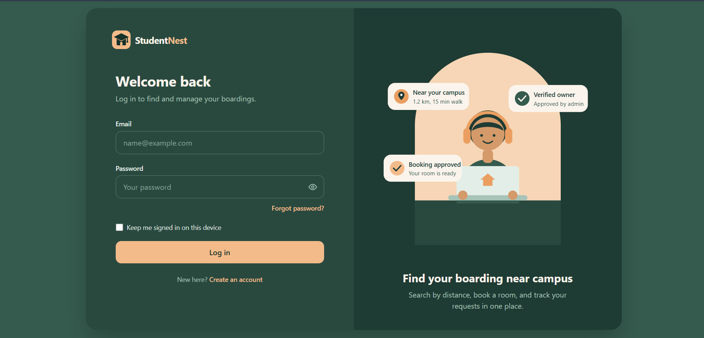<br>**Login** | 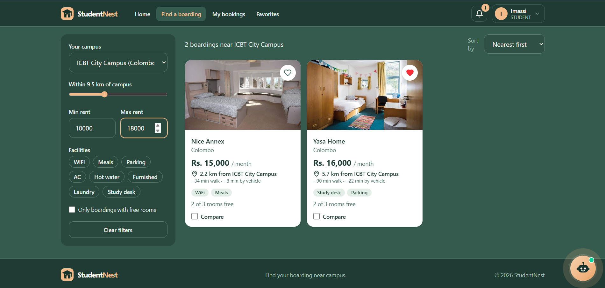<br>**Student: find a boarding near a campus** |
| 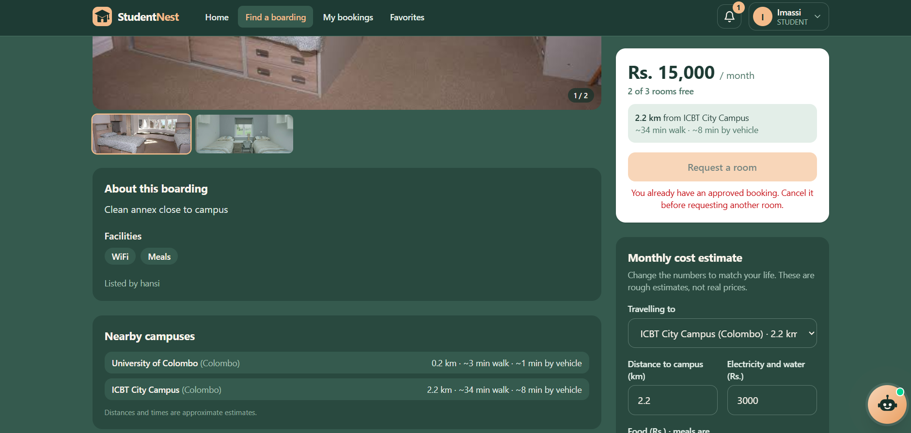<br>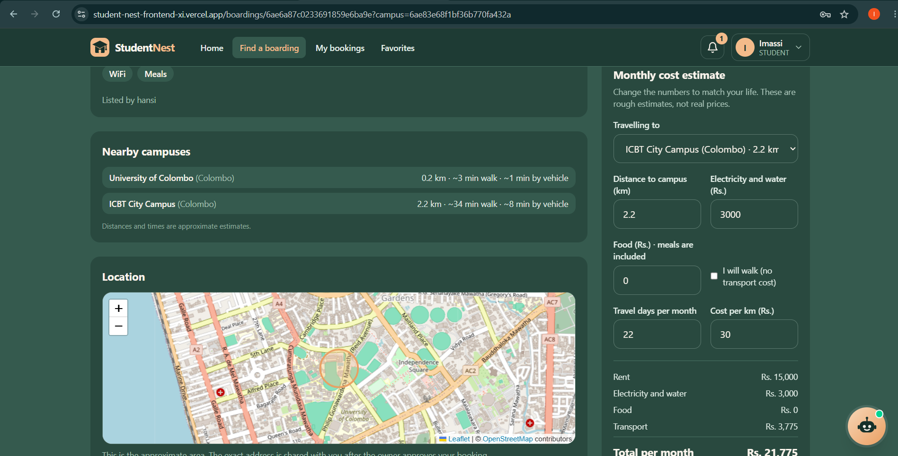<br>**Student: boarding details and cost calculator** | 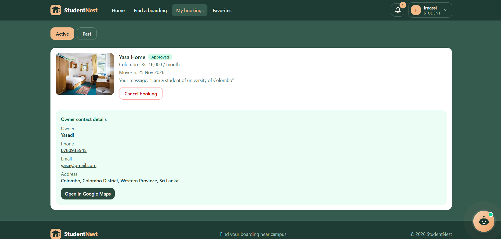<br>**Student: contact details after approval** |
| 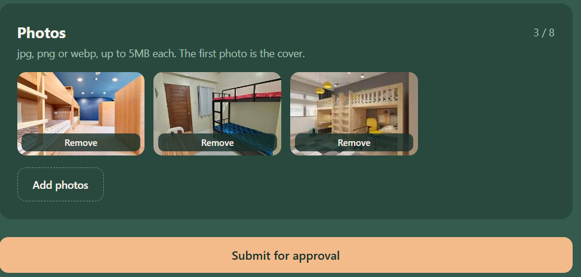<br>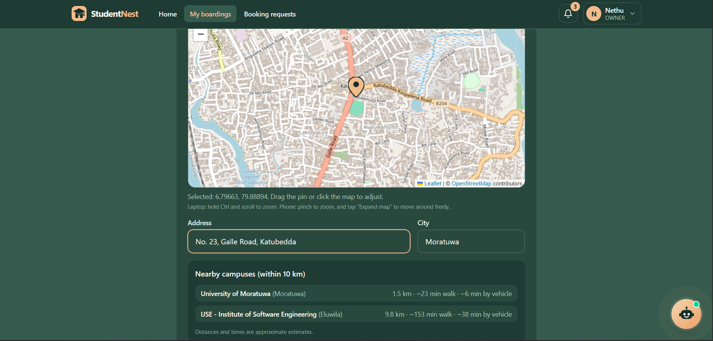<br>**Owner: add a boarding (map and photos)** | 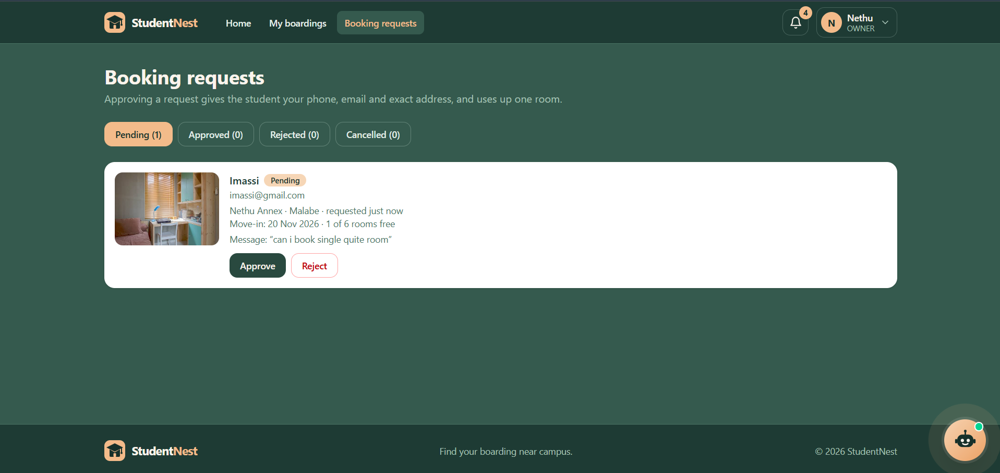<br>**Owner: booking requests** |
| 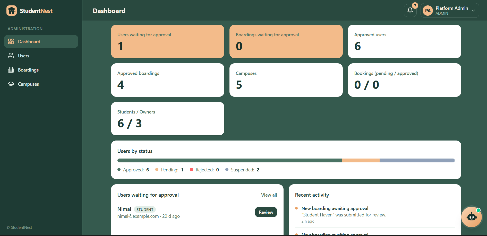<br>**Admin: dashboard** | 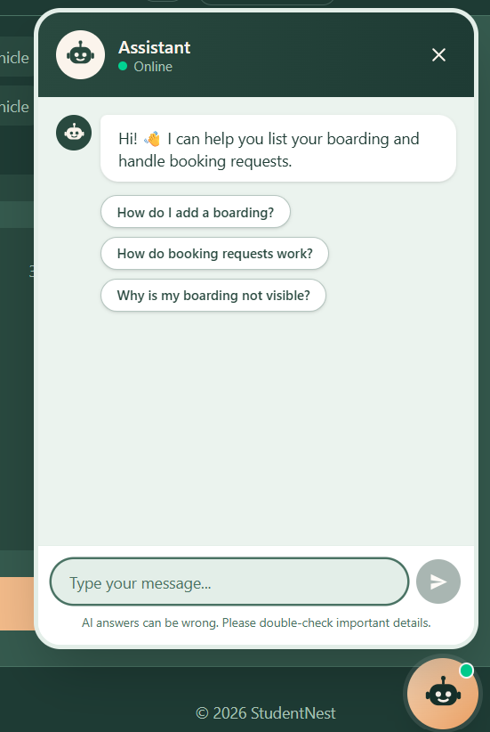<br>**AI chat assistant** |

### Mobile

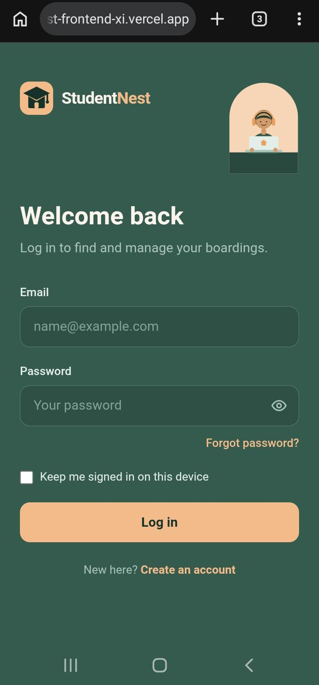
